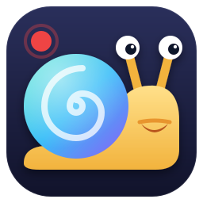

<p align="center"></p>

# Den Den

Câmera redonda flutuante + gravador de tela para Linux (X11), feito para o i3.
O nome vem do Den Den Mushi de One Piece, o caracol que transmite vídeo.

- Bolha redonda da webcam por cima de tudo, inclusive de apps em tela cheia
- Arrasta com o mouse, muda de tamanho na rodinha, fica transparente com o mouse em cima
- Grava a tela inteira com áudio do PC e/ou microfone (H.264 via VAAPI quando disponível)
- Ícone na bandeja do sistema (i3bar e qualquer bandeja XEmbed) com menu de controle

## Instalar

Dependências (Ubuntu/Debian):

```sh
sudo apt install python3-gi python3-gi-cairo gir1.2-gtk-3.0 ffmpeg libnotify-bin
```

```sh
make install     # em ~/.local, sem sudo
make uninstall
make deb         # gera denden_<versão>_all.deb
```

## Usar

| Onde | Ação |
|---|---|
| Bolha | botão esquerdo arrasta, rodinha redimensiona, botão do meio grava/para, botão direito abre o menu |
| Bandeja | qualquer clique abre o menu |
| Terminal | `denden --gravar` e `denden --camera` controlam a instância aberta |

Atalhos para o i3:

```
bindsym $mod+Shift+r exec --no-startup-id denden --gravar
bindsym $mod+c exec --no-startup-id denden --camera
```

Os vídeos vão para a pasta de vídeos do usuário (`xdg-user-dir VIDEOS`).
`DENDEN_CAM=/dev/video1` troca a câmera.


